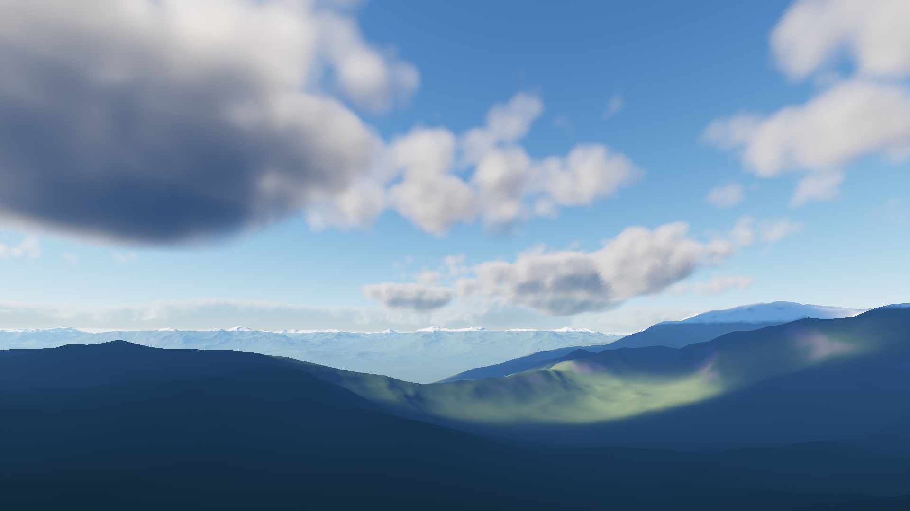
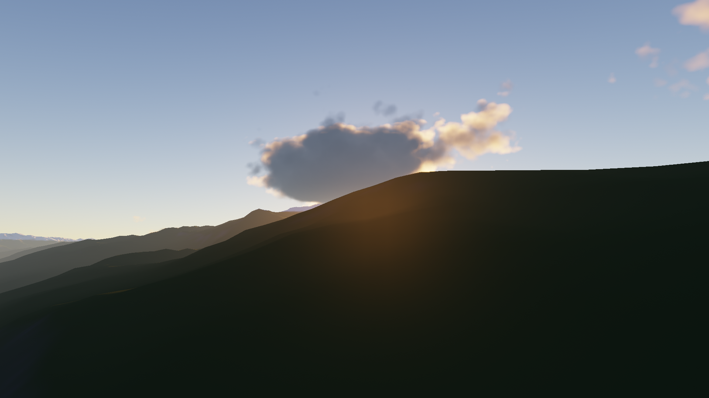
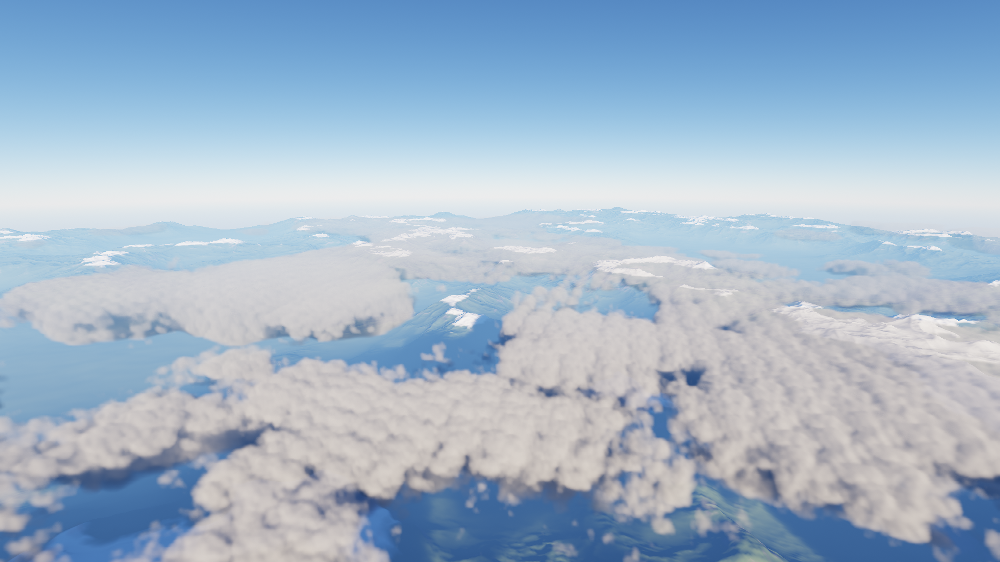
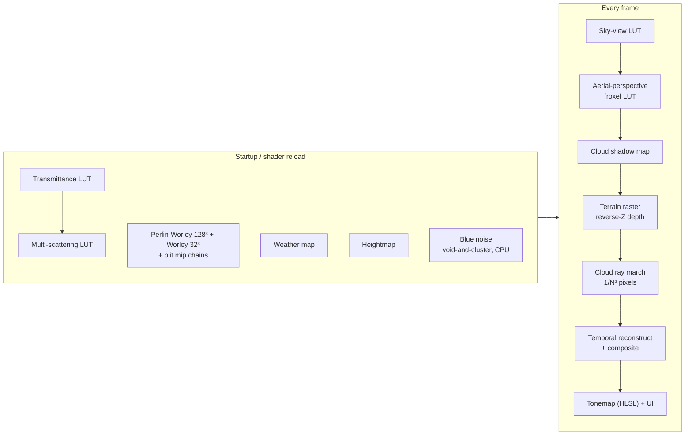
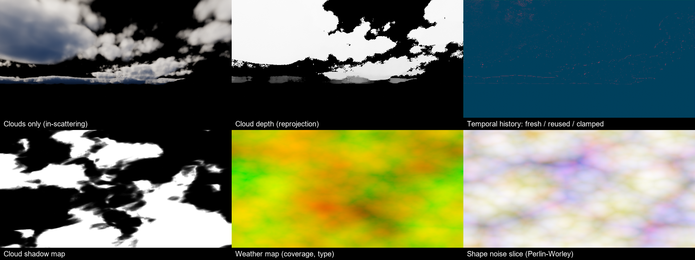

# Nimbus

[](https://github.com/DarrelFW321/Nimbus/actions/workflows/build.yml)

**Real-Time Volumetric Renderer** · C++20 · Vulkan 1.3 · GLSL + HLSL · RenderDoc

A real-time renderer for physically based volumetric clouds over procedural terrain, with a
Hillaire-style atmosphere, temporal reconstruction and an automated GPU benchmark. Every
optimization is a runtime toggle, so each speed-up in the table below is measured, not estimated.



| | |
|---|---|
|  |  |

## Highlights

- **40.8 ms → 2.38 ms GPU frame time (17×)** at 1920×1080 on an RTX 3050 Laptop GPU, measured
  with an automated, deterministic benchmark (1.73 ms / 23.6× with 4×4 reconstruction).
- **Volumetric clouds** ray-marched through a spherical cloud shell: 3D Perlin-Worley noise,
  weather map with cloud types, Beer-Lambert extinction, dual-lobe Henyey-Greenstein phase,
  multiple-scattering approximation and energy-conserving integration.
- **Temporal reconstruction**: clouds are marched for 1 of every N×N pixels per frame (Bayer order),
  reprojected with a transmittance-weighted cloud depth and rectified with neighbourhood clamping.
- **Physically based sky**: transmittance, multiple-scattering, sky-view and aerial-perspective
  (froxel) LUTs after Hillaire 2020, so sunsets, sun colour and haze fall out of the model.
- **Dynamic lighting**: the sun drives the sky LUTs, cloud lighting, a cloud shadow map projected
  onto the terrain, and aerial perspective, all updated every frame.
- **Raster + compute integration**: reverse-Z terrain pass whose depth bounds the cloud march,
  so mountains correctly occlude and pierce the cloud layer.
- **Profiling tooling**: per-pass GPU timestamp queries, debug-utils labels and object names for
  RenderDoc/Nsight, RenderDoc in-app capture API, shader hot reload, headless benchmark and
  screenshot modes.

## Performance

`nimbus --benchmark` replays the same 390-frame camera path for each configuration (90 warm-up,
300 measured frames) and writes [docs/benchmark_results.md](docs/benchmark_results.md) plus a CSV.
Each row keeps every optimization above it. Times are mean GPU milliseconds from timestamp queries.

RTX 3050 Laptop GPU, 1920×1080, Release build:

| Configuration | GPU frame (ms) | p95 (ms) | Speed-up | Clouds (ms) | Terrain (ms) |
|---|---:|---:|---:|---:|---:|
| Baseline: procedural noise, full-res march, 128 steps | 40.79 | 43.04 | 1.0× | 38.04 | 0.77 |
| + precomputed 3D noise textures (mipmapped) | 12.19 | 13.05 | 3.3× | 10.18 | 1.17 |
| + early ray termination (T < 1%) | 9.69 | 10.37 | 4.2× | 7.64 | 1.23 |
| + adaptive empty-space stepping | 6.17 | 7.30 | 6.6× | 4.09 | 1.20 |
| + cheap far light-march samples | 6.01 | 6.84 | 6.8× | 3.90 | 1.24 |
| + 96 steps (temporal accumulation hides the noise) | 5.37 | 6.15 | 7.6× | 3.27 | 1.26 |
| + 2×2 temporal reconstruction (¼ of the rays) | 3.10 | 3.23 | 13.2× | 1.04 | 1.23 |
| + indexed terrain mesh | 3.02 | 3.15 | 13.5× | 1.07 | 1.11 |
| **+ aerial-perspective froxel LUT (shipping default)** | **2.38** | **2.72** | **17.1×** | 1.15 | 0.39 |
| Default with 4×4 reconstruction (1/16 of the rays) | 1.73 | 2.00 | 23.6× | 0.54 | 0.40 |
| Default with 16×8 cloud workgroups | 2.56 | 2.73 | 15.9× | 1.24 | 0.45 |
| Default with 16×16 cloud workgroups | 2.58 | 2.75 | 15.8× | 1.26 | 0.46 |
| Default with 8×4 cloud workgroups | 3.05 | 3.39 | 13.4× | 1.80 | 0.44 |

The full per-pass breakdown (sky-view LUT, aerial-perspective LUT, cloud shadow map, terrain,
clouds, reconstruction, tonemap) is in [docs/benchmark_results.md](docs/benchmark_results.md).

What the numbers say:

- **Procedural noise was the bottleneck.** Evaluating fBm per sample cost 3.7× more than sampling
  precomputed, mipmapped 3D textures. The textures are also cache-friendly at distance.
- **Most rays are mostly empty.** Adaptive stepping (3× steps through empty space using the cheap
  shape-only density, then backing up one step on a hit) halved the march on its own.
- **Temporal reconstruction is the biggest single win.** Marching ¼ of the pixels cut the cloud pass
  from 3.27 to 1.04 ms. The reconstruction pass itself costs a constant ~0.37 ms.
- **Not every win came from the clouds.** Once clouds were cheap, profiling showed the terrain's
  per-pixel atmosphere integral at 1.1 ms. Replacing it with a 32³ froxel LUT (0.03 ms to build)
  brought terrain down to 0.39 ms. Indexing the terrain grid (up to 6× fewer vertex invocations)
  helped less than expected (−0.12 ms), which shows the pass was fragment-bound.
- **Workgroup shape matters a little.** 8×8 was best. 8×4 lost 0.65 ms on the cloud pass, likely
  because 32-thread groups hit the per-SM workgroup limit before filling the SM's thread slots.

## Frame structure



All passes share one descriptor set layout and one pipeline layout. Resources stay in `GENERAL`
layout and passes are separated by `vkCmdPipelineBarrier2` memory barriers (synchronization2).
The two attachments use explicit layout transitions. Rendering uses dynamic rendering (no render
passes), two frames in flight, and ping-pong history images that alternate with the frame-in-flight
index.

## Techniques

| Area | Implementation | Files |
|---|---|---|
| Cloud density | Weather map (coverage + type), per-type height gradients, Perlin-Worley base shape, Worley detail erosion (wispy base / billowy top), wind drift and shear | [clouds.glsl](shaders/clouds.glsl) |
| Cloud lighting | Cone light march toward the sun, Beer-Lambert, dual-lobe Henyey-Greenstein, Wrenninge multiple-scattering octaves, powder term, sky ambient from the sky-view LUT, energy-conserving integration (Hillaire 2015) | [clouds.comp](shaders/clouds.comp) |
| Ray marching | Spherical shell intersection (stable quadratic for planet-scale radii), depth-bounded by terrain, blue-noise + golden-ratio jitter, adaptive stepping, early termination, distance-based mip LOD | [clouds.comp](shaders/clouds.comp) |
| Temporal | N×N Bayer sub-pixel rotation, reprojection with transmittance-weighted cloud depth, 3×3 neighbourhood clamp, bilinear fallback on disocclusion | [reconstruct.comp](shaders/reconstruct.comp) |
| Atmosphere | Rayleigh / Mie / ozone, Bruneton transmittance parameterisation, multi-scattering LUT, sky-view LUT, aerial-perspective froxel volume, sun disc with limb darkening | [atmosphere.glsl](shaders/atmosphere.glsl), `*_lut.comp` |
| Noise | Tileable gradient and cellular noise on the GPU. CPU void-and-cluster blue noise (Ulichney 1993) | [noise.glsl](shaders/noise.glsl), [blue_noise.cpp](src/blue_noise.cpp) |
| Terrain | Buffer-less grid from `gl_VertexIndex`, warped for density near the camera, planet curvature, slope/altitude materials, cloud shadow map, reverse-Z | [terrain.vert](shaders/terrain.vert), [terrain.frag](shaders/terrain.frag) |
| Post | ACES tonemap and blue-noise dither before 8-bit sRGB quantisation, written in HLSL and compiled with DXC | [tonemap.hlsl](shaders/tonemap.hlsl) |



*Built-in debug views: clouds only, cloud depth used for reprojection, temporal history (green =
marched this frame, blue = reprojected, red = clamped / rejected), cloud shadow map, weather map,
and a slice of the shape noise.*

## Build

Requirements: Vulkan SDK 1.3 (provides glslc and dxc), CMake ≥ 3.24, Ninja, MinGW-w64 GCC (tested
with GCC 16.1), and a Vulkan 1.3 GPU. GLFW, vk-bootstrap, GLM, VMA, Dear ImGui, stb and the
RenderDoc API header are fetched by CMake.

```sh
cmake -S . -B build-release -G Ninja -DCMAKE_BUILD_TYPE=Release
cmake --build build-release
cd build-release && ./nimbus.exe
```

Use `-DCMAKE_BUILD_TYPE=Debug` to enable the Vulkan validation layers. The full benchmark sweep
runs with zero validation errors.

## Usage

| Input | Action |
|---|---|
| Right mouse drag | Look |
| W A S D / Q E | Move / down, up (Shift = fast) |
| F1 | Toggle UI |
| F2 | Save screenshot to `screenshots/` |
| F5 | Recompile all shaders (glslc + DXC) and rebuild pipelines |
| F11 | RenderDoc capture (when attached) |

The UI exposes every optimization toggle, step counts, upscale factor, workgroup shape, cloud and
lighting parameters, debug views and a live per-pass GPU timing breakdown.

| Command line | |
|---|---|
| `--benchmark [file.md]` | Run the optimization sweep and write the report |
| `--screenshot file.png [--shot noon\|sunset\|above] [--frames N]` | Render a converged frame and exit |
| `--camera x,y,z,yawDeg,pitchDeg` / `--sun azDeg,elevDeg` / `--coverage v` | Scene overrides |
| `--upscale 1\|2\|4` / `--debug-view N` / `--fly m/s` | Reconstruction and debugging |
| `--hidden` / `--width W --height H` / `--exit-after N` | Headless runs |
| `--renderdoc` | Load `renderdoc.dll` for in-app captures |

The README images were produced with `--hidden --width 1920 --height 1080 --screenshot docs/<shot>.png --shot <shot>`.

## Profiling workflow

1. **Live timers.** `GpuProfiler` brackets every pass with `vkCmdWriteTimestamp2` and shows a
   smoothed per-pass breakdown in the UI.
2. **A/B toggles.** Each optimization is a bit in a uniform flags word, so its cost can be flipped
   at runtime without recompiling.
3. **Benchmark.** `--benchmark` turns those toggles into a reproducible table (mean and p95).
4. **RenderDoc.** Launch from RenderDoc (working directory `build-release/`) or run with
   `--renderdoc` and press F11. Passes appear as named debug-utils regions ("Clouds (ray march)",
   "Temporal reconstruct", …) and every image carries a debug name. Shaders are compiled with
   `-g` / `-Zi`, so GLSL and HLSL source is available in the shader debugger.

## Project layout

```
src/
  renderer.{h,cpp}         Vulkan setup, resources, frame graph, settings -> uniforms
  vk_helpers.{h,cpp}       images, barriers, mip generation, debug-utils labels
  gpu_profiler.{h,cpp}     timestamp-query scopes
  benchmark.{h,cpp}        automated optimization sweep + Markdown/CSV report
  blue_noise.{h,cpp}       void-and-cluster generator
  shader_compiler.{h,cpp}  runtime glslc/DXC invocation for hot reload
  renderdoc_integration.*  RenderDoc in-application API
  camera.h, main.cpp       fly camera, CLI, ImGui panel
shaders/
  common.glsl              uniforms, bindings, shared helpers
  atmosphere.glsl          sky model + LUT parameterisations
  clouds.glsl, clouds.comp cloud density and ray marcher
  reconstruct.comp         temporal reconstruction + composite
  *_lut.comp, noise_*.comp, weather.comp, heightmap.comp, cloud_shadow.comp
  terrain.vert/.frag       raster terrain
  tonemap.hlsl             HLSL final pass (DXC -> SPIR-V)
```

## Limitations and next steps

- Clouds use a fade-to-sky approximation for aerial perspective rather than sampling the froxel LUT.
- No light shafts (crepuscular rays). The cloud shadow map would make an epipolar or froxel pass straightforward.
- The terrain is a single warped grid without continuous LOD. Distant vertices pop slightly as the
  camera-centred grid snaps.
- CI ([.github/workflows/build.yml](.github/workflows/build.yml)) only compiles the renderer and shaders
  (GitHub runners have no GPU), so rendering and performance are verified locally.

## References

- A. Schneider, *The Real-Time Volumetric Cloudscapes of Horizon Zero Dawn*, SIGGRAPH 2015 Advances.
- A. Schneider, *Nubis: Authoring Real-Time Volumetric Cloudscapes with the Decima Engine*, SIGGRAPH 2017 Advances.
- S. Hillaire, *Physically Based Sky, Atmosphere and Cloud Rendering in Frostbite*, SIGGRAPH 2016 Course.
- S. Hillaire, *A Scalable and Production Ready Sky and Atmosphere Rendering Technique*, EGSR 2020.
- E. Bruneton, *Precomputed Atmospheric Scattering: a New Implementation*, 2017.
- M. Wrenninge et al., *Oz: The Great and Volumetric*, SIGGRAPH 2013 Talks.
- R. Ulichney, *The void-and-cluster method for dither array generation*, SPIE 1993.
